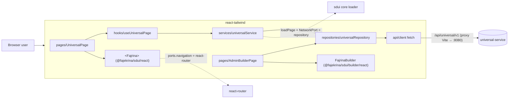
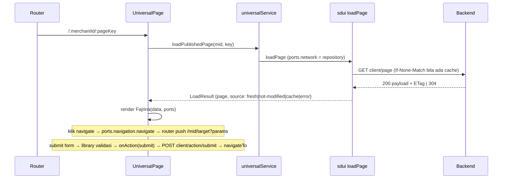
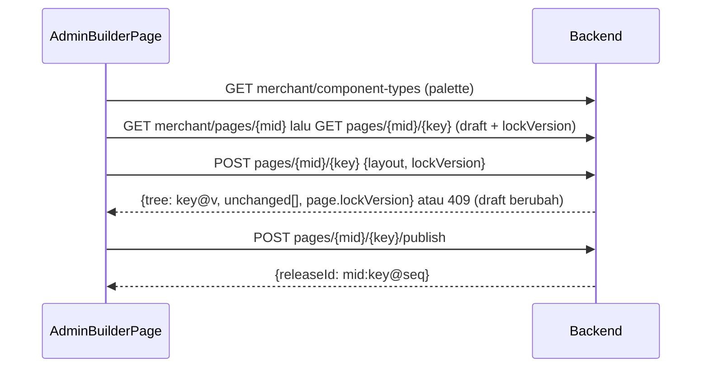

# HANDOFF — react-tailwind (aplikasi konsumen React)

> Tanggal: 2026-11-10 · Memakai `@fajekrina/sdui` 0.3.0 (workspace link ke `packages/sdui`)
> Pasangan: `packages/sdui/HANDOFF.md`, `universal-service/HANDOFF.md`, `vue-bootstrap/HANDOFF.md`

## 1. Apa ini
Demo React 18 + react-router 6 + Tailwind 4. Halaman `/:merchantId/:pageKey` dirender sepenuhnya dari JSON
backend; `/admin/builder` adalah builder (Save/Publish ke backend).

## 2. Desain sistem

### 2.1 Posisi dalam sistem


### 2.2 Lapisan aplikasi
| Lapisan | Tanggung jawab | Tidak boleh |
|---|---|---|
| `api/client.ts` | fetch ke `/api/universal/v1`, `raw()` untuk status/header (ETag), pesan error dari `errorMessage` | logika bisnis |
| `repositories/` | 1:1 endpoint backend (client + merchant) | cache, validasi |
| `services/` | memasang repository sebagai **NetworkPort** untuk `loadPage` library sdui (ETag, last-good cache, validasi ulang); `submitAction` | menyentuh UI |
| `hooks/useUniversalPage` | state halaman: `data`, `error`, `source`, `loading`; abort request lama | memanggil fetch langsung |
| `pages/` | routing, `ports.navigation` → router, `onAction` hanya untuk `submit` | merender komponen SDUI sendiri |

Styling demo (Tailwind) hanya untuk shell halaman (banner error/offline); komponen SDUI tetap inline style dari library sdui.

### 2.3 Alur halaman publik


### 2.4 Alur admin builder


### 2.5 Kontrak yang dipakai
- Backend (base `/api/universal/v1`, error `{errorDesc, errorCode, errorMessage}`): `GET client/page/{mid}/{key}` (ETag/304), `POST client/action/submit`, `GET|POST merchant/pages/...`, `POST .../publish`, `POST .../rollback?to=`, `GET merchant/releases/...` (`{releases:[…]}`), `GET merchant/component-types`.
- Library sdui: `loadPage`, `resolvePorts`, `browserStorage`, `<Fajrina data ports onAction>`; `FajrinaActionEvent.behavior` `submit` ditangani aplikasi, `blocked` hanya di-log, sisanya ditangani library.

## 3. Status
| | |
|---|---|
| Tes | `npx vitest run` → 3 tes lulus (`src/services/universalService.test.ts`) |
| Build | `npm run build` (tsc -b + vite) bersih |
| Live | dev server 5173 → proxy `/api` ke 8080: ETag + 304 lewat proxy terverifikasi |

## 4. Menjalankan
```bash
# backend dulu: universal-service → ./gradlew bootRun (8080)
npm run build -w @fajekrina/sdui     # dari root C:\sdui, bila library sdui berubah
npm run dev                          # http://localhost:5173/merchant_demo/home
```

## 5. Yang berubah (ikut sdui 0.3)
- `repositories/universalRepository.ts`: `fetchPublishedPage` mengembalikan `{status, body, etag}` dan mengirim `If-None-Match`; merchant repo + `publish` (mengembalikan `releaseId`), `rollback`, `releases`, `componentTypes`, `save(..., lockVersion)`.
- `services/universalService.ts`: memakai `loadPage` library sdui dengan repository sebagai **NetworkPort** (ETag, last-good cache, validasi ulang). `loadPublishedPage` tidak pernah throw; lihat `source`.
- `hooks/useUniversalPage.ts`: `data/error/source/loading`, abort request lama.
- `pages/UniversalPage.tsx`: `ports.navigation` → react-router (`navigate`, `back`, `openExternal`); `onAction` hanya mengurus `submit` (ke `/client/action/submit`); banner error + banner offline (`source === 'cache'`). Error field form kini dirender library.
- `pages/AdminBuilderPage.tsx`: palette dari `GET /merchant/component-types`; simpan mengirim `lockVersion` (409 → pesan "draft diubah di tempat lain"); status publish menampilkan `merchant:page@seq`.
- `api/client.ts`: base `/api/universal/v1` (backend kini berversi), pesan error dibaca dari `errorMessage` (kontrak error baru backend), `raw()` (tanpa throw, akses header) dan `put()`.

## 6. Catatan
- `navigate` dari SDUI sekarang lewat port: parameter aksi (mis. `seatId`) diteruskan sebagai query string.
- `src/pages/NotFoundPage.tsx`, router, util route tidak berubah.
- Belum diuji klik di browser sungguhan oleh saya (hanya build, unit test, dan request lewat proxy dev).

## 7. Langkah berikut
- Tambah halaman riwayat release + tombol rollback di admin (repo sudah menyediakan `releases`/`rollback`).
- E2E (Playwright) untuk alur home → seat-selection → checkout.

## Spec screens demo (branch `feat/versioned-screens`)
Aplikasi ini memakai engine `@fajekrina/sdui` (paket lokal, branch `feat/builder-adopt-0.3`) — versi sdui 0.3.x
ada di branch `sdui-0.3.x`.

- `src/sdui/config.ts` — allow-list aplikasi: `ENDPOINTS` (`submitCheckout` → `POST /client/action/submit`),
  `LINKS` (https), `ASSETS` (nama gambar → URL). Payload hanya menyebut nama.
- `src/sdui/engine.ts` — `createSduiEngine`: screen + manifest dari universal-service, cache IndexedDB,
  `PayloadSecurity.insecureDevelopment` (signing backend default mati; untuk produksi pakai `signed(...)` + `?signed=true`).
- `ScreenPage` — `/:merchantId/:screenKey?param=…`; query = seed (`{{seatId}}`); manifest di-refresh tiap screen.
- `AdminBuilderPage` — `<SduiBuilder>` (drag-drop, preview, editor aksi dari allow-list) → save/publish ke
  `merchant/screens`; lock dijaga `screenService`.

Jalankan: universal-service di 8080, lalu `npm run dev`. Tes: `npm test` (engine vs seed screens, alur builder).
Setelah pindah dari `sdui-0.3.x`: `npm install` dari `C:\sdui` agar `@fajekrina/sdui` kembali ke paket lokal.
